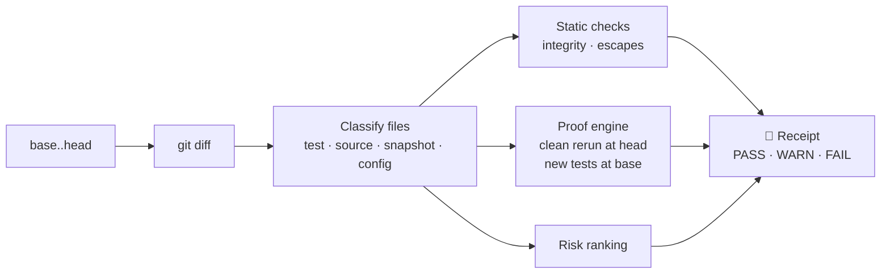

<div align="center">

# 🧾 trustbut

### Trust, but verify, for AI coding agents.

**Your agent said it's done and the tests pass. trustbut shows you what's actually true.**

[](https://github.com/isAlmogK/trustbut/actions/workflows/ci.yml)
[](LICENSE)
[](https://nodejs.org)
[](docs/ROADMAP.md)

[Why](#why-im-building-this) · [Install](#install) · [Usage](#usage) · [What it checks](#what-it-checks) · [CI](#use-it-in-ci) · [How it works](#how-it-works) · [FAQ](#faq) · [Roadmap](docs/ROADMAP.md)

</div>

---

trustbut is a local command-line tool that produces a **receipt** for any change an AI coding agent makes. It reruns your tests from scratch, checks whether the agent's new tests actually prove anything, and flags skipped tests, deleted assertions and silenced type checks. Then it gives you a **PASS / WARN / FAIL** verdict you can read in 30 seconds.

It works with **any agent** (Claude Code, Codex, Cursor, Gemini CLI, OpenCode, Copilot) because it only needs git and your test runner. No LLM, no server, no account. Your code never leaves your machine.

```console
$ npx github:isAlmogK/trustbut verify

## 🧾 Receipt: WARN

`3f2a91c` → `8be04d1` · runner: vitest

**Tests (clean checkout):** 41 passed · 0 failed · 1 skipped
**New/changed tests:** 1 prove the change · 1 pass without it

### Findings
- ⚠ **Test passes without the change** · `test/auth.test.ts`: rejects expired token
- ⚠ **Test skipped** · `test/auth.test.ts:88`: it.skip('handles clock skew', () => {
- ⚠ **cast to any** · `src/auth/session.ts:41`: const claims = decoded as any;

### Review these first
1. `src/auth/session.ts`: auth/permissions, has findings
2. `package.json`: dependencies
```

The output is Markdown, so the same receipt reads cleanly in your terminal and renders properly in a pull request or a CI job summary.

## Why I'm building this

AI agents now write a large share of the code I ship. Writing it is no longer the slow part. **Checking it is.**

Agents are good, and they are also confidently *almost right*. An agent reports "all tests pass" while the suite is red. It adds a test that would pass with or without its change. It skips the one test that was failing, or casts to `any` to make a type error go away. None of this is malicious; it's what happens when a system is optimised to finish the task. But it means every "done" needs checking, and reading the diff alone won't show what actually ran.

The data says I'm not alone:

- In the [2026 Stack Overflow survey](https://survey.stackoverflow.co/2026/ai), **48%** of developers trust AI output when they can easily validate it, but only **16%** trust it for most tasks. The gap between those numbers is the problem trustbut works on.
- In 2025, **66%** of developers named "almost right, but not quite" as their top frustration with AI tools ([InfoWorld on the 2025 survey](https://infoworld.com/article/4031673/ai-use-among-software-developers-grows-but-trust-remains-an-issue-stack-overflow-survey.html)).
- Armin Ronacher put it well in [The Final Bottleneck](https://lucumr.pocoo.org/2026/2/13/the-final-bottleneck/): generating code is now cheaper than reviewing it, and the human stays accountable.

The existing tools don't close that gap. AI code reviewers read the diff and comment, but they never rerun anything. Agent vendors are adding their own checks, but a vendor grading its own agent is a weak audit, and most teams use more than one agent anyway.

So I want something **independent, deterministic and local**: evidence, not opinions. trustbut doesn't ask an AI whether the code looks right. It runs things and reports what is true.

## Install

> [!NOTE]
> trustbut is in early alpha and **not on npm yet**. Until the first release, run it straight from GitHub; the build happens automatically.

**Requirements:** Node.js 22 or newer, git, and a repository that uses **Vitest** or **pytest** (Jest is next).

**Run without installing (recommended):**

```bash
npx github:isAlmogK/trustbut verify
```

**Install globally:**

```bash
npm install -g github:isAlmogK/trustbut
trustbut verify
```

**From source:**

```bash
git clone https://github.com/isAlmogK/trustbut.git
cd trustbut
npm ci
npm link
```

Once it's published, `npx trustbut verify` will work too.

## Usage

Run it in your repository after an agent finishes and the changes are committed:

```bash
trustbut verify
```

By default trustbut compares your branch with the point where it split off `main` (or `master`), the same way a GitHub pull request shows its diff.

### Common recipes

```bash
# Compare against a specific branch or commit
trustbut verify --base develop
trustbut verify --base HEAD~3

# Faster: rerun only the new and changed test files at head
trustbut verify --quick

# Gate a script or CI job on warnings as well as failures
trustbut verify --strict

# Machine-readable output
trustbut verify --json > receipt.json
```

### Options

| Option | Description | Default |
|---|---|---|
| `-b, --base <ref>` | Base branch or commit, compared from its merge-base with head | `origin/main`, `main`, `origin/master` or `master` |
| `--head <ref>` | The commit to verify | `HEAD` |
| `--runner <name>` | Force a test runner: `vitest` or `pytest` | detected automatically |
| `--quick` | At head, rerun only the new and changed test files | off (full suite) |
| `--strict` | Exit with `1` on WARN as well as FAIL | off |
| `--json` | Print the receipt as JSON instead of Markdown | off |

### Verdicts and exit codes

| Verdict | Meaning | Exit code |
|---|---|---|
| ✅ **PASS** | Tests are green from a clean checkout, the new tests prove the change, and nothing suspicious was found | `0` |
| ⚠️ **WARN** | Something deserves a human look: a test that passes without the change, a skipped test, a silenced check | `0` (`1` with `--strict`) |
| ✖️ **FAIL** | Tests fail from a clean checkout, a changed test fails, or a test was focused (`.only`) | `1` |
| — | Usage or runtime error, e.g. an unknown ref or option | `2` |

> [!TIP]
> trustbut only looks at **committed** changes. If you have uncommitted work, the receipt says so. Commit first (or let your agent commit) to include it.

## What it checks

### 1. A clean rerun

Your test suite runs in a fresh, temporary `git worktree` at head, not in your working directory and not by trusting the agent's own run. A red suite is a **FAIL**.

### 2. Fail-before / pass-after proof

This is the core idea. Every new or changed test also runs against the **base** commit:

| Before the change | After the change | Result |
|---|---|---|
| fails | passes | ✅ **Proves the change** |
| passes | passes | ⚠️ **Passes without the change**: the test doesn't check the new behaviour |
| — | fails | ✖️ **Fails at head** |
| — | skipped | ⚠️ **Skipped** |
| couldn't run (e.g. imports code that didn't exist yet) | passes | ✅ Counted, but marked as *couldn't run at base* |

### 3. Test integrity

| Finding | Severity |
|---|---|
| Test focused (`it.only`, `describe.only`, `fit`, `fdescribe`) | ✖️ FAIL |
| Test skipped (`it.skip`, `xit`, `@pytest.mark.skip`, `@unittest.skip`, `pytest.skip()`, `self.skipTest()`) | ⚠️ WARN |
| Tests removed (net count) | ⚠️ WARN |
| Assertions removed (net count, including `self.assertEqual` style) | ⚠️ WARN |
| Snapshot changed or deleted | ⚠️ WARN |
| Test or coverage config changed | ⚠️ WARN |
| Source changed but no tests were added or changed | ⚠️ WARN |

### 4. Escapes

New lines that silence the type checker, linter or coverage:

| Language | Flagged |
|---|---|
| TypeScript / JavaScript | `as any`, `: any`, `@ts-ignore`, `@ts-nocheck`, `@ts-expect-error`, `eslint-disable`, `istanbul` / `c8` / `v8 ignore` |
| Python | `# type: ignore`, `# noqa`, `# pragma: no cover` |

Checks look at real code and comments only, so a string or regex that merely *mentions* `it.only` doesn't trigger a false alarm.

### 5. Review these first

A ranked list of the files that deserve your attention: auth and permissions, database migrations, CI pipelines, dependencies, secrets and env files, infrastructure, agent config (`.claude/`, `AGENTS.md`, …), files with findings, and very large changes.

## Use it in CI

Add a receipt to every pull request, shown in the job summary. A FAIL fails the job:

```yaml
# .github/workflows/trustbut.yml
name: trustbut
on: pull_request
permissions:
  contents: read
jobs:
  receipt:
    runs-on: ubuntu-latest
    steps:
      - uses: actions/checkout@v4
        with:
          fetch-depth: 0          # trustbut needs history to find the merge-base
      - uses: actions/setup-node@v4
        with:
          node-version: 22
      - run: npm ci
      - name: trustbut receipt
        shell: bash               # keeps trustbut's exit code through the pipe
        env:
          BASE_REF: ${{ github.base_ref }}
        run: npx github:isAlmogK/trustbut verify --base "origin/${BASE_REF}" | tee -a "$GITHUB_STEP_SUMMARY"
```

A dedicated GitHub Action that posts the receipt as a PR comment is on the [roadmap](docs/ROADMAP.md).

## How it works



- **Throwaway worktrees.** Both runs happen in temporary `git worktree`s that are always removed afterwards. Your working directory is never touched. Dependencies (`node_modules`, `.venv`) are linked from your checkout instead of reinstalled.
- **JUnit everywhere.** Runners report through JUnit XML, so adding a new runner is a small adapter.
- **Deterministic.** The same commits give the same receipt. There's no model, no sampling and no network call in the core.

## FAQ

<details>
<summary><b>Does it send my code anywhere or use an LLM?</b></summary>

No. trustbut runs entirely on your machine with git and your own test runner. There is no AI model, no telemetry and no account.
</details>

<details>
<summary><b>Which agents does it work with?</b></summary>

All of them. trustbut verifies the *result* (your git history and your tests), so it doesn't matter whether Claude Code, Codex, Cursor, Gemini CLI, OpenCode, Copilot or a human wrote the change. Deeper integrations that read agent transcripts are on the roadmap.
</details>

<details>
<summary><b>Is it a replacement for code review?</b></summary>

No. It's the evidence you want *before* a review: did the tests really run, do the new tests prove anything, and what got silenced. It points your attention at the right files so a human review takes minutes, not an hour.
</details>

<details>
<summary><b>Isn't running the tests twice slow?</b></summary>

The base run only executes the new and changed test files, not the whole suite. Use `--quick` to also limit the head run to those files.
</details>

<details>
<summary><b>Is it safe to run?</b></summary>

trustbut runs your repository's tests, which means running your code, the same trust as running `npm test` or `pytest`. It does this in temporary worktrees and never modifies your checkout. In CI, use `pull_request` (not `pull_request_target`) with read-only permissions, as in the example above.
</details>

<details>
<summary><b>Why "trustbut"?</b></summary>

From "trust, but verify." Agents are genuinely useful, so keep trusting them, but check the evidence before you merge. The command reads as the idea: `trustbut verify`.
</details>

## Roadmap

- **v0.2:** a Claude Code panel that shows the receipt when the agent finishes a turn, and `trustbut ui`, a local web view with the receipt beside the diff
- **v0.3:** read agent transcripts and check claims like "tests pass" against what actually ran
- **v0.4:** GitHub Action with PR comments, a VS Code / Cursor extension, and Jest support
- **Later:** mutation testing on changed lines, and `trustbut compare` to score several agents' attempts at the same task

See the full [roadmap](docs/ROADMAP.md) and the [design spec](docs/SPEC.md).

## Contributing

Contributions are welcome, especially **real agent mistakes the receipt should have caught**. Open an issue with a minimal repro; it becomes a test scenario before it gets a fix.

```bash
npm ci
npm test           # unit and end-to-end tests (real git repos, real test runs)
npm run typecheck
npm run build
```

trustbut is built with AI coding agents and verified by itself: every pull request gets its own trustbut receipt in CI. The rules agents follow in this repo are in [AGENTS.md](AGENTS.md).

## License

[Apache-2.0](LICENSE)

---

<div align="center">

Built by [@isAlmogK](https://github.com/isAlmogK). If trustbut saves you from a bad merge, a ⭐ helps others find it.

</div>
