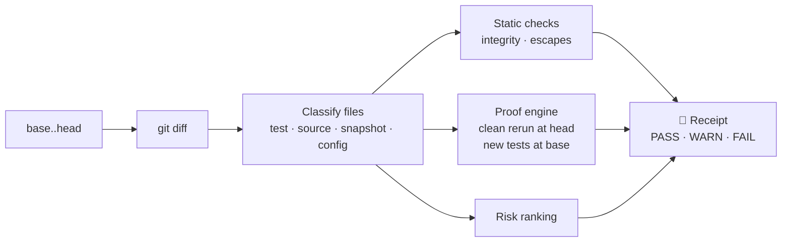

<div align="center">

# 🧾 trustbut

### Trust, but verify, for AI coding agents.

**Your agent said it's done and the tests pass. trustbut shows you what's actually true.**

[](https://www.npmjs.com/package/trustbut)
[](https://github.com/isAlmogK/trustbut/actions/workflows/ci.yml)
[](LICENSE)
[](https://nodejs.org)
[](docs/ROADMAP.md)
[](#supported-languages)
[](https://github.com/sponsors/isAlmogK)

🧾 *Verified by trustbut: pull requests to this repo carry its own trustbut receipt.*

[Languages](#supported-languages) · [Why](#why-im-building-this) · [Field results](#field-results) · [Install](#install) · [Usage](#usage) · [Use it with your agent](#use-it-with-your-agent) · [Config](#configuration-trustbutjson) · [What it checks](#what-it-checks) · [Receipt format](#the-agent-receipts-format) · [CI](#use-it-in-ci) · [How it works](#how-it-works) · [FAQ](#faq) · [Roadmap](docs/ROADMAP.md) · [Sponsor](#sponsor) · [About me](#about-me)

</div>

---

trustbut is a local command-line tool that produces a **receipt** for any change an AI coding agent makes. It reruns your tests from scratch, checks whether the agent's new tests actually prove anything, and flags skipped tests, deleted assertions and silenced type checks. Then it gives you a **PASS / WARN / FAIL** verdict you can read in 30 seconds. Wired into your agent, it can also stop the agent from finishing while the receipt is FAIL, so it keeps fixing until the evidence holds up ([details](#use-it-with-your-agent)).

It works with **any agent** (Claude Code, Codex, Cursor, Gemini CLI, OpenCode, Copilot) and **every major language** (JavaScript/TypeScript, Python, Go, Rust, Java, Kotlin, C#, Ruby, PHP, Dart/Flutter and Swift) because it only needs git and your test runner. No LLM, no server, no account. Your code never leaves your machine.

```console
$ npx trustbut verify

## 🧾 Receipt: WARN

`3f2a91c` → `8be04d1` · runner: vitest

**Tests (clean checkout):** 41 passed · 0 failed · 1 skipped
**New/changed tests:** 1 prove the change · 1 pass without it

### Findings
- ⚠ **Test passes without the change** · `test/auth.test.ts`: rejects expired token
- ⚠ **Test skipped** · `test/auth.test.ts:88`: it.skip('handles clock skew', () => {
- ⚠ **cast to any** · `src/auth/session.ts:41`: const claims = decoded as any;

### Review these first
1. `src/auth/session.ts`: auth/permissions, has findings
2. `package.json`: dependencies
```

When the suite fails at head, the receipt also lists the failing tests. If `package.json` declares dependencies that aren't installed in your `node_modules` (a stale install), a `deps-not-installed` warning names them, because both runs link and use your installed dependencies. See the finding ids in the spec's [finding catalog](spec/agent-receipt-v1.md#finding-catalog).

The output is Markdown, so the same receipt reads cleanly in your terminal and renders properly in a pull request or a CI job summary.

## Supported languages

| Language | Test frameworks | Tamper and escape checks | Verified in CI against the real toolchain |
|---|---|---|---|
| JavaScript / TypeScript | Vitest, Jest (incl. Expo / React Native), Mocha, `node:test` | ✅ | ✅ |
| Python | pytest | ✅ | ✅ |
| Go | `go test` | ✅ | ✅ |
| Rust | cargo-nextest, `cargo test` | ✅ | ✅ |
| Java | Maven, Gradle | ✅ | ✅ |
| Kotlin | Maven, Gradle | ✅ | ◐ same runners as Java; Kotlin end-to-end test coming |
| C# / .NET | `dotnet test` (xUnit verified; NUnit and MSTest via the same TRX results) | ✅ | ✅ |
| Ruby | RSpec | ✅ | ✅ |
| PHP | PHPUnit | ✅ | ✅ |
| Dart / Flutter | `dart test`, `flutter test` | ✅ | ✅ |
| Swift | Swift Package Manager (XCTest, Swift Testing) | ✅ | ✅ |
| Anything else | any command that writes JUnit XML | — | ✅ |

trustbut detects the right runner automatically, including in monorepo subfolders. Setup steps (such as starting a database emulator), extra arguments and environment variables go in a [`.trustbut.json`](#configuration-trustbutjson). Detection rules and the exact commands are in [Supported languages and test runners](#supported-languages-and-test-runners).

## Why I'm building this

AI agents now write a large share of the code I ship. Writing it is no longer the slow part. **Checking it is.**

Agents are good, and they are also confidently *almost right*. An agent reports "all tests pass" while the suite is red. It adds a test that would pass with or without its change. It skips the one test that was failing, or casts to `any` to make a type error go away. None of this is malicious; it's what happens when a system is optimised to finish the task. But it means every "done" needs checking, and reading the diff alone won't show what actually ran.

The data says I'm not alone:

- In the [2026 Stack Overflow survey](https://survey.stackoverflow.co/2026/ai), **48%** of developers trust AI output when they can easily validate it, but only **16%** trust it for most tasks. The gap between those numbers is the problem trustbut works on.
- In 2025, **66%** of developers named "almost right, but not quite" as their top frustration with AI tools ([InfoWorld on the 2025 survey](https://infoworld.com/article/4031673/ai-use-among-software-developers-grows-but-trust-remains-an-issue-stack-overflow-survey.html)).
- Armin Ronacher put it well in [The Final Bottleneck](https://lucumr.pocoo.org/2026/2/13/the-final-bottleneck/): generating code is now cheaper than reviewing it, and the human stays accountable.

The labs see the same thing in their own models:

- Anthropic's [Claude 3.7 Sonnet system card](https://www.anthropic.com/claude-3-7-sonnet-system-card) reports the model special-casing tests, and sometimes modifying them, to make them pass in agentic coding environments like Claude Code. The [Claude 4 system card](https://www.anthropic.com/claude-4-system-card) reports this much reduced, but still present.
- OpenAI's [research on monitoring reasoning models](https://arxiv.org/abs/2503.11926) caught a model exiting early or skipping unit tests to look green. When the training pushed hard against this, the model learned to "hide their intent while continuing to misbehave."
- [METR](https://metr.org/blog/2025-06-05-recent-reward-hacking/) found frontier models patching the grading and scoring code of their evaluations, and [ImpossibleBench](https://arxiv.org/abs/2510.20270) now measures how often models exploit tests on tasks that can't be solved honestly.

These shortcuts get rarer as models improve, but they don't go away, and they get harder to spot by reading the agent's own account of what it did. That makes a deterministic check from outside the agent more useful, not less.

The existing tools don't close the gap. AI code reviewers read the diff and comment, but they never rerun anything. Agent vendors are adding their own checks, but a vendor grading its own agent is a weak audit, and most teams use more than one agent anyway. Even a perfect agent is still the one reporting on its own work: compilers almost never miscompile, and we still run CI.

So I want something **independent, deterministic and local**: evidence, not opinions. trustbut doesn't ask an AI whether the code looks right. It runs things and reports what is true.

## Field results

Before releasing, I ran trustbut on the repos of [DogBase](https://www.dogbase.co), my own app. Nothing dramatic turned up, and that's the point: these are the quiet gaps a diff review doesn't show.

| Repo | Verdict | What the receipt showed |
|---|---|---|
| Mobile app (Expo, Jest, 543 tests) | WARN | 299 of the branch's 306 new or changed tests failed before the change and passed after it. **7 passed with or without the change**, so they prove nothing about this branch. They may be fine regression tests, or padding that makes the change look better tested than it is. You can't tell from the diff; you can from the receipt. |
| Firebase Cloud Functions (Vitest, 320 tests) | WARN | Two new `eslint-disable-next-line` comments silencing a lint rule. |
| Web app (SvelteKit, Vitest, 3,168 tests) | FAIL | A fix commit with no test, and 5 failing tests caused by a dependency declared in `package.json` but missing from the local install. That second finding became the `deps-not-installed` warning. |

Every finding was real, and two of them changed the product. Have a run of your own? [Open an issue](https://github.com/isAlmogK/trustbut/issues) with what the receipt found, or missed.

## Install

**Requirements:** Node.js 22 or newer, git, and a repository with tests in one of the [supported languages and test runners](#supported-languages-and-test-runners), or any runner that can write JUnit XML. The toolchain of your project (Go, Cargo, Maven, .NET, Composer, …) must be installed, as it is when you run the tests yourself.

**Run without installing (recommended):**

```bash
npx trustbut verify
```

> [!NOTE]
> trustbut 0.3.0 is being published to npm. Until 0.3.0 is on npm, run it straight from GitHub instead (the build happens automatically): `npx github:isAlmogK/trustbut verify`.

**Install globally:**

```bash
npm i -g trustbut
trustbut verify
```

**From source:**

```bash
git clone https://github.com/isAlmogK/trustbut.git
cd trustbut
npm ci
npm link
```

To have your agent verify its own work after every turn, see [Use it with your agent](#use-it-with-your-agent).

## Usage

Run it in your repository after an agent finishes:

```bash
trustbut verify            # the committed work on your branch
trustbut verify --working  # uncommitted work too (tracked edits plus untracked files)
```

By default trustbut compares your branch with the point where it split off `main` (or `master`), the same way a GitHub pull request shows its diff.

### Common recipes

```bash
# Compare against a specific branch or commit
trustbut verify --base develop
trustbut verify --base HEAD~3

# Verify uncommitted work (the agent hasn't committed yet)
trustbut verify --working

# Faster: rerun only the new and changed test files at head
trustbut verify --quick

# The tests live in a subfolder, or the config lives outside the repo
trustbut verify --root services/api
trustbut verify --config ~/configs/myapp.trustbut.json

# Gate a script or CI job on warnings as well as failures
trustbut verify --strict

# Machine-readable output (an agent receipt v1)
trustbut verify --json > receipt.json
```

### Options

| Option | Description | Default |
|---|---|---|
| `-b, --base <ref>` | Base branch or commit, compared from its merge-base with head | `origin/main`, `main`, `origin/master` or `master` |
| `--head <ref>` | The commit to verify (not with `--working`) | `HEAD` |
| `--working` | Verify uncommitted work: tracked edits plus untracked, non-ignored files, snapshotted without touching your index | off |
| `--runner <name>` | Force a test runner, any name from the [table below](#supported-languages-and-test-runners) | detected automatically |
| `--root <dir>` | Package folder to run the tests in, relative to the repo root (overrides `root` in the config) | `.` |
| `--config <path>` | Use this config file instead of `.trustbut.json` at head; it may live outside the repo | `.trustbut.json` |
| `--quick` | At head, rerun only the new and changed test files | off (full suite) |
| `--strict` | Exit with `1` on WARN as well as FAIL | off |
| `--json` | Print the receipt as JSON: an [agent receipt v1](spec/agent-receipt-v1.md) | off |
| `--receipt-json <path>` | Also write the JSON receipt to this file (relative to the current directory; parent folders are created) | off |
| `--receipt-md <path>` | Also write the Markdown receipt to this file | off |

### Verdicts and exit codes

| Verdict | Meaning | Exit code |
|---|---|---|
| ✅ **PASS** | Tests are green from a clean checkout, the new tests prove the change, and nothing suspicious was found | `0` |
| ⚠️ **WARN** | Something deserves a human look: a test that passes without the change, a skipped test, a silenced check | `0` (`1` with `--strict`) |
| ✖️ **FAIL** | Tests fail from a clean checkout, a changed test fails, or a test was focused (`.only`) | `1` |
| — | Usage or runtime error, e.g. an unknown ref or option, or a `--receipt-json` / `--receipt-md` file that couldn't be written | `2` |

> [!TIP]
> By default trustbut only looks at **committed** changes. If you have uncommitted work, the receipt says so. Commit first, or pass `--working` to include it.

## Use it with your agent

trustbut can run itself at the end of every agent turn, so a FAIL receipt never reaches you as "done".

> [!NOTE]
> The commands below assume `trustbut` is installed globally (`npm i -g trustbut`). Until 0.3.0 is on npm, the plugin and the `init` hooks need `trustbut` on your PATH: install it with `npm i -g github:isAlmogK/trustbut`, or run `npx github:isAlmogK/trustbut init <agent>` instead of `trustbut init <agent>`.

**What happens**

1. When the agent finishes a turn, trustbut quickly verifies its work: your uncommitted changes plus the commits on your branch. By default it reruns only the new and changed test files (the whole suite when none changed).
2. **FAIL:** the agent gets the receipt (failing tests with their messages, focused tests, and so on) and keeps fixing. This repeats up to `hook.maxRetries` times in a row (default 3), then the agent is allowed to stop and you see the FAIL.
3. **WARN or PASS:** you get a one-line note and the agent finishes.
4. trustbut never blocks on its own errors: a timeout, a crash or a missing tool lets the agent finish with a "couldn't verify" note.
5. A tree already verified isn't rerun. A FAIL is sent back once per tree: if the agent stops again without changing anything, or you start a new turn with nothing changed, it is allowed to finish and you see the FAIL with the receipt path.

After each completed check, the full Markdown receipt is at `.git/trustbut/last-receipt.md` (per worktree; inside `.git`, so it is never committed).

Things to know:

- The hooks run on macOS and Linux (POSIX) for now; Windows isn't supported yet.
- Use either the Claude Code plugin or `trustbut init claude`, not both: with both, every turn is checked twice.
- The hook runs your tests outside the agent's sandbox; see [Is it safe to run?](#faq).

### Claude Code

Install the plugin from this repository's marketplace:

```
/plugin marketplace add isAlmogK/trustbut
/plugin install trustbut@trustbut
```

Or write the hook into your project without the plugin: `trustbut init claude` (use one or the other, not both). The plugin uses the `trustbut` on your PATH when it is recent enough, and otherwise runs `npx trustbut@<version>`. Both run the hook in exec form (`args`), which needs a recent Claude Code (2.1 or later).

When trustbut sends a FAIL back, Claude Code labels it "Stop hook error occurred". This is expected: it is how Claude Code shows a blocking Stop hook, and the receipt is still delivered to the agent.

### Codex

```bash
trustbut init codex
```

Codex asks you to approve new hooks: open `/hooks` and approve **trustbut verify** (needs Codex 0.129 or later). Project hooks load only in trusted projects.

### Gemini CLI

```bash
trustbut init gemini
```

Project hooks run only in trusted folders, so trust the folder in Gemini CLI if the hook doesn't fire. Needs Gemini CLI 0.35 or later.

### OpenCode

```bash
trustbut init opencode
```

This writes a plugin for the OpenCode V1 plugin API (`opencode-ai` 1.x; V2 support is a follow-up). OpenCode can't block "done", so on a FAIL the receipt is sent back to the agent as a follow-up prompt instead.

### Init options

`trustbut init <claude|codex|gemini|opencode>` copies a small runner script next to the agent's config and, for Claude Code, Codex and Gemini CLI, merges one hook entry into it, leaving your other hooks alone. For OpenCode it writes a plugin file instead. It is safe to rerun: it updates its own entry in place.

| Option | What it does |
|---|---|
| `--dry-run` | Print what would change and write nothing |
| `--user` | Set up your user-level config (`~/.claude`, `~/.codex`, `~/.gemini`, `~/.config/opencode`) instead of the project |

Project files are written at the git root, and agents read project settings from the directory they were started in, so start the agent from the repo root. A settings file that contains comments is refused (exit `2`) with the snippet to add by hand.

### Skip it or tune it

Set `TRUSTBUT_SKIP=1` in the environment to skip the check for a session (for example `TRUSTBUT_SKIP=1 claude`). To change how it behaves, add a `hook` object to [`.trustbut.json`](#configuration-trustbutjson). It is read as committed at `HEAD`, so an uncommitted edit by the agent can't switch it off.

```json
{ "hook": { "mode": "full", "maxRetries": 2 } }
```

| Key | Type | Default | Description |
|---|---|---|---|
| `enabled` | boolean | `true` | `false` lets every stop through without verifying |
| `mode` | `"quick"` or `"full"` | `"quick"` | `quick` reruns only the new and changed test files at head; `full` reruns the whole suite |
| `maxRetries` | whole number, 0 to 100 | `3` | How many times in a row a FAIL is sent back to the agent. `0` reports a FAIL without ever blocking |
| `timeoutSec` | number above 0 | `540` | Time budget for one check, kept under the agents' 600 s hook timeout. When it runs out the agent is allowed to finish |
| `base` | ref name | origin's default branch, then `origin/main`, `main`, `origin/master`, `master`, then the branch's upstream, else `HEAD` | What to compare against |

The hook protocols, exit codes and environment variables are in the [spec](docs/SPEC.md#7-agent-hooks-trustbut-hook-agent).

## Supported languages and test runners

trustbut picks the runner by looking at the package folder (the repo root, or `root` / `--root`) as committed at head (with `--working`, your working tree). If several match, the most specific one wins; force one with `--runner <name>` or `"runner"` in the config.

| Runner | Language | Detected by | Runs | Notes |
|---|---|---|---|---|
| `vitest` | JS / TS | `vitest` dependency, or `vitest.config.*` / `vitest.workspace.*` | `vitest run --reporter=junit` | Wins over Jest when both are present |
| `jest` | JS / TS | `jest` dependency or config, `jest.config.*`, or a `jest-expo` / `react-native` preset | `jest --ci --json --runTestsByPath <files>` | Works for Expo and React Native apps |
| `mocha` | JS / TS | `mocha` dependency or `.mocharc.*` | `mocha --reporter json` | |
| `node-test` | JS / TS | `scripts.test` in `package.json` uses `node --test` | `node --test` | Uses the built-in `node:test` runner |
| `pytest` | Python | `pytest.ini`, `conftest.py`, `tox.ini`, or `[tool.pytest` in `pyproject.toml` | `python -m pytest -q --junitxml` | Uses the checkout's `.venv` / `venv` if present |
| `go` | Go | `go.mod` | `go test -json -count=1 ./...` | Add `"args": ["-p", "1"]` for packages that share a database or emulator |
| `cargo` | Rust | `Cargo.toml` | `cargo nextest run` if installed, else `cargo test --no-fail-fast` | Also checks `#[cfg(test)]` modules in source files. Proofs come from integration tests under `tests/`: inline `#[cfg(test)]` tests run in the suite but give no fail-before / pass-after proof, since they live in the source file being changed |
| `maven` | Java / Kotlin | `pom.xml` (the `mvnw` wrapper is preferred) | `mvn -B test` (Surefire reports) | |
| `gradle` | Java / Kotlin | `build.gradle(.kts)` or `settings.gradle(.kts)` (the `gradlew` wrapper is preferred) | `gradle test --continue` | |
| `dotnet` | C# | a `.sln`, `.slnx`, `.csproj` or `.fsproj` in the root | `dotnet test` (TRX results) | With several projects it prefers the solution file |
| `rspec` | Ruby | `.rspec`, or `spec/` plus `rspec` in the `Gemfile` | `bundle exec rspec --format json` | Plain `rspec` when there is no Gemfile |
| `phpunit` | PHP | `phpunit.xml(.dist)`, or `phpunit/phpunit` in `composer.json` | `vendor/bin/phpunit --log-junit` | Runs `composer install` in the temporary checkout, since `vendor/` isn't tracked |
| `dart` | Dart | `pubspec.yaml` with a `test` dev dependency | `dart test --reporter json` | Runs `dart pub get` first when `.dart_tool` is missing |
| `flutter` | Dart / Flutter | `pubspec.yaml` with the Flutter SDK | `flutter test --machine` | |
| `swift` | Swift | `Package.swift` | `swift test --parallel --verbose --xunit-output` | Swift Package Manager projects |
| `command` | anything | never detected; chosen with `command` in the config | your command | See below |

Each runner's own report (JUnit XML, JSON events or TRX, depending on the tool) is turned into the same per-test results, so each language gets the same fail-before / pass-after proof.

### Any other runner: the `command` runner

If your tests run through something not listed, point trustbut at a command that writes **JUnit XML**:

```json
{
  "command": "./run-tests.sh {files}",
  "junit": "test/reports/junit.xml"
}
```

`{files}` is replaced with the quoted changed test files (and with nothing for a full run). Without `junit`, trustbut reads the command's stdout if it is JUnit XML. Setting `command` selects the `command` runner automatically.

## Configuration (`.trustbut.json`)

Everything is optional; most projects need no config at all. Put `.trustbut.json` in the repo root. trustbut reads it **as committed at head** (so the version under review is the one used), then falls back to the working-tree file. `--config <file>` uses a different file instead, which can live outside the repo. Unknown keys and wrong types are errors (exit code `2`) that list the allowed keys; a `$schema` key is ignored.

| Key | Type | Default | Description |
|---|---|---|---|
| `root` | string | `"."` | Package folder relative to the repo root. Runners are detected and run there, and only changed test files under it are rerun (changed tests elsewhere are listed as not run). Must stay inside the repo and exist at head (otherwise exit code `2`). `--root` overrides it. |
| `runner` | string | detected | Force a runner from the table above. `--runner` overrides it. |
| `command` | string | none | The `command` runner: shell command to run. `{files}` becomes the quoted test files (nothing for a full run). |
| `junit` | string | none | The `command` runner: JUnit XML file the command writes, relative to `root`. |
| `setup` | string | none | Shell command started in the background before **each** test run (for example an emulator or database), and always killed afterwards. If it exits non-zero before the tests start, the run stops with exit code `2`. |
| `setupReadyPattern` | regex string | none | Tests start as soon as `setup` prints a line matching this (stdout or stderr). |
| `setupWaitSec` | number, 0 to 2,000,000 | `5` | How long to wait for `setup`; with `setupReadyPattern` it is the maximum wait. |
| `env` | object of strings | none | Extra environment variables for every test run and for `setup`. |
| `args` | string[] | none | Extra arguments added to the runner's command: before the test files (or packages, selectors) for most runners; for Maven, Gradle and .NET at the end; for `swift` after the `--filter` options; for the `command` runner appended (shell-quoted) at the very end of the command. |
| `timeoutSec` | number, up to 2,000,000 | `900` | Time limit for each test run; the receipt says when a run timed out. |

### Examples

**1. A Go backend with a Firebase emulator, in a subfolder**

```json
{
  "root": "backend",
  "args": ["-p", "1"],
  "setup": "firebase emulators:start --only firestore,auth",
  "setupReadyPattern": "All emulators ready",
  "setupWaitSec": 90,
  "env": { "FIRESTORE_EMULATOR_HOST": "127.0.0.1:8080" }
}
```

`-p 1` runs packages one at a time so they don't fight over the emulator. The emulator is started before the head run and again before the base run, and always shut down.

**2. An Expo / React Native app with Jest**

```json
{
  "runner": "jest",
  "args": ["--silent"]
}
```

Usually you don't need any config: `jest-expo` and `react-native` presets are detected. Dependencies are linked from your checkout, so there's no reinstall.

**3. Vitest in a `functions/` subfolder**

```json
{ "root": "functions" }
```

Or skip the file and run `trustbut verify --root functions`.

**4. Any other tool, through the `command` runner**

```json
{
  "command": "./scripts/run-tests.sh {files}",
  "junit": "build/test-results/junit.xml",
  "timeoutSec": 1800
}
```

> [!WARNING]
> `command` and `setup` are shell commands that run as part of verification, from the config at head, just like a changed `test` script in `package.json` would. Only verify code you'd be willing to run.

## What it checks

### 1. A clean rerun

Your test suite runs in a fresh, temporary `git worktree` at head, not in your working directory and not by trusting the agent's own run. A red suite is a **FAIL**.

### 2. Fail-before / pass-after proof

This is the core idea. Every new or changed test also runs against the **base** commit:

| Before the change | After the change | Result |
|---|---|---|
| fails | passes | ✅ **Proves the change** |
| passes | passes | ⚠️ **Passes without the change**: the test doesn't check the new behaviour |
| — | fails | ✖️ **Fails at head** |
| — | skipped | ⚠️ **Skipped** |
| couldn't run (e.g. imports code that didn't exist yet) | passes | ✅ Counted, but marked as *couldn't run at base* |

### 3. Test integrity

| Finding | Severity |
|---|---|
| Test focused (`it.only`, `describe.only`, `fit`, `fdescribe`, RSpec `focus: true`, Dart `solo: true`) | ✖️ FAIL |
| Test skipped (`it.skip`, `xit`, `@pytest.mark.skip`, `t.Skip()`, `#[ignore]`, `@Disabled`, `[Ignore]`, `markTestSkipped`, `XCTSkip`, `skip:` …) | ⚠️ WARN |
| Tests removed (net count) | ⚠️ WARN |
| Assertions removed (net count, including `self.assertEqual` style) | ⚠️ WARN |
| Snapshot changed or deleted | ⚠️ WARN |
| Test or coverage config changed | ⚠️ WARN |
| Source changed but no tests were added or changed | ⚠️ WARN |

### 4. Escapes

New lines that silence the type checker, linter or coverage:

| Language | Skip / focus markers | Escapes flagged |
|---|---|---|
| TypeScript / JavaScript | `.only`, `fit`, `fdescribe` (FAIL); `.skip`, `.todo`, `xit`, `xdescribe` | `as any`, `: any`, `@ts-ignore`, `@ts-nocheck`, `@ts-expect-error`, `eslint-disable`, `istanbul` / `c8` / `v8 ignore` |
| Python | `@pytest.mark.skip` / `skipif` / `xfail`, `@unittest.skip`, `pytest.skip()`, `self.skipTest()` | `# type: ignore`, `# noqa`, `# pragma: no cover` |
| Go | `t.Skip()`, `t.SkipNow()`, `t.Skipf()` | `//nolint`, `//lint:ignore`, `//go:build ignore`, `unsafe.*` |
| Rust | `#[ignore]` | `#[allow(…)]`, `#[expect(…)]`, `unsafe` blocks |
| Java | `@Disabled`, `@Ignore` | `@SuppressWarnings`, `@SuppressFBWarnings`, `NOPMD`, `CHECKSTYLE:OFF` |
| Kotlin | `@Disabled`, `@Ignore` | `@Suppress`, `@SuppressLint`, `ktlint-disable` |
| C# | `[Ignore]`, `[Explicit]`, `Skip =`, `Assert.Ignore()` | `#pragma warning disable`, `SuppressMessage`, `#nullable disable`, `ExcludeFromCodeCoverage` |
| Ruby | `focus: true` / `:focus` and `fit` (FAIL); `skip`, `pending`, `xit` | `rubocop:disable`, `:nocov:` |
| PHP | `markTestSkipped()`, `markTestIncomplete()`, Pest `->skip()` / `->todo()` | `@phpstan-ignore`, `@psalm-suppress`, `phpcs:ignore`, `@codeCoverageIgnore`, `@` error suppression |
| Dart | `solo: true` (FAIL); `skip: true` / a reason string, `@Skip` | `// ignore:`, `// ignore_for_file:`, `coverage:ignore-*` |
| Swift | `XCTSkip`, `XCTSkipIf`, `.disabled(…)` | `swiftlint:disable`, `@unchecked Sendable` |

Checks look at real code and comments only, so a string or regex that merely *mentions* `it.only` doesn't trigger a false alarm. Removed tests and assertions are counted per language too (`@Test`, `func Test…`, `#[test]`, `assert_eq!`, `Assert.*`, …).

### 5. Review these first

A ranked list of the files that deserve your attention: auth and permissions, database migrations, CI pipelines, dependencies, secrets and env files, infrastructure, agent config (`.claude/`, `AGENTS.md`, …), files with findings, and very large changes.

## The agent receipts format

`trustbut verify --json` prints an **agent receipt**: an open, versioned JSON format for evidence about a code change. Any tool can produce one and any tool can read one, and trustbut is just the reference implementation. The [spec](spec/agent-receipt-v1.md) defines a small required core (`specVersion`, `producer`, `subject`, `verdict`, `findings`), optional standard sections (`tests`, `proofs`, `risks`), 19 core finding ids with fixed meanings, namespaced ids like `acme/secret-leak` for everything else, and `x-` keys for tool-specific data.

Check any receipt, from trustbut or anything else, against the spec:

```console
$ trustbut verify --json | trustbut validate
valid
```

The schema is [`spec/agent-receipt-v1.schema.json`](spec/agent-receipt-v1.schema.json), and examples are in [`spec/examples/`](spec/examples/). Building a tool that emits receipts? Open an issue and I'll link it here.

## Use it in CI

The trustbut GitHub Action adds a receipt to your pull requests: a sticky comment (updated in place on each push), the receipt in the job summary, and a failed job on FAIL.

> [!NOTE]
> `@v0` resolves after the first release (until 0.3.0 is on npm and the `v0.3.0` Release exists). Until then pin `isAlmogK/trustbut@v0.3.0` (once that tag exists). Before anything is published, `isAlmogK/trustbut@main` works only with `version: local`, which builds the action's own checkout.

```yaml
# .github/workflows/trustbut.yml
name: trustbut
on: pull_request
permissions:
  contents: read
  pull-requests: write   # for the sticky comment
jobs:
  receipt:
    runs-on: ubuntu-latest
    steps:
      - uses: actions/checkout@v4
        with:
          fetch-depth: 0   # trustbut needs history to find the merge-base
      # add your language's setup and dependency install here (setup-node + npm ci, setup-go, ...)
      - uses: isAlmogK/trustbut@v0
```

The action installs Node 22 if the runner has none or one older than 22; that Node stays on the PATH for later steps in the job. Add your own language's `setup-*` step and dependency install before it, and a `.trustbut.json` in the repo if your tests need setup.

**Inputs** (all optional)

| Input | Default | Description |
|---|---|---|
| `base` | the PR base branch, else the repo default branch | Base branch to compare against |
| `strict` | `false` | Fail on WARN as well as FAIL |
| `config` | none | Path to a trustbut config file |
| `root` | none | Package folder to run tests in, relative to the repo root |
| `working-directory` | `.` | Directory to run trustbut from |
| `version` | the version matching the action's ref | npm version of trustbut to run, or `local` to build and run the action's own checkout |
| `node-version` | none | Force a Node version (by default Node 22 is installed only if the runner has no Node 22 or newer) |
| `comment` | `true` | Post or update the sticky PR comment |
| `comment-key` | `default` | Tell several comments on one PR apart, for example one per monorepo package |
| `github-token` | `${{ github.token }}` | Token for the comment (needs `pull-requests: write`) |
| `comment-author` | `github-actions[bot]` | Login whose comment is updated in place; set it when `github-token` is a PAT or GitHub App token |

**Outputs**

| Output | Description |
|---|---|
| `verdict` | `pass`, `warn`, `fail` or `error` |
| `exit-code` | trustbut's exit code: `0`, `1` for FAIL (or WARN with `strict`), `2` for an error |
| `receipt-path` | Path to the Markdown receipt |
| `comment-url` | URL of the sticky comment (empty if none was posted) |

**Pull requests from forks** get the receipt in the job summary only: GitHub gives them a read-only token, so no comment is posted. Always use the `pull_request` event, **never `pull_request_target`**: trustbut runs the PR's tests, and `pull_request_target` would run them with a write token and your secrets (the action prints a warning if you do).

## How it works



- **Throwaway worktrees.** Both runs happen in temporary `git worktree`s that are always removed afterwards. Your working directory is never touched. Dependencies (`node_modules`, `.venv`) are linked from your checkout instead of reinstalled; other toolchains (Go, Cargo, Maven, …) use their usual caches.
- **Runner and language registries.** Each runner is a small adapter that turns a test command into per-test results, and each language declares how to read its comments, strings and test markers. Adding either is one file.
- **Deterministic.** The same commits give the same receipt. There's no model, no sampling and no network call in the core.

## FAQ

<details>
<summary><b>Does it send my code anywhere or use an LLM?</b></summary>

No. trustbut runs entirely on your machine with git and your own test runner. There is no AI model, no telemetry and no account.
</details>

<details>
<summary><b>Which agents does it work with?</b></summary>

All of them. trustbut verifies the *result* (your git history and your tests), so it doesn't matter whether Claude Code, Codex, Cursor, Gemini CLI, OpenCode, Copilot or a human wrote the change. Agents with a turn-end hook (Claude Code, Codex, Gemini CLI, OpenCode) can also run trustbut automatically: see [Use it with your agent](#use-it-with-your-agent). Deeper integrations that read agent transcripts are on the roadmap.
</details>

<details>
<summary><b>Is it a replacement for code review?</b></summary>

No. It's the evidence you want *before* a review: did the tests really run, do the new tests prove anything, and what got silenced. It points your attention at the right files so a human review takes minutes, not an hour.
</details>

<details>
<summary><b>Isn't running the tests twice slow?</b></summary>

The base run only executes the new and changed test files, not the whole suite. Use `--quick` to also limit the head run to those files.
</details>

<details>
<summary><b>Is it safe to run?</b></summary>

trustbut runs your repository's tests, which means running your code, the same trust as running `npm test` or `pytest`. It does this in temporary worktrees and never modifies your checkout. In CI, use `pull_request` (not `pull_request_target`), as in the example above.

With an agent hook, keep in mind that the check runs **outside the agent's sandbox**: at the end of each turn your tests, including ones the agent just wrote, and the `command`/`setup` in `.trustbut.json` run with your permissions and network access. Where that matters (an untrusted repo, an agent you run sandboxed), turn the hook off with `"hook": { "enabled": false }` in `.trustbut.json` or `TRUSTBUT_SKIP=1`, and run `trustbut verify` yourself in a sandbox.
</details>

<details>
<summary><b>Why "trustbut"?</b></summary>

From "trust, but verify." Agents are genuinely useful, so keep trusting them, but check the evidence before you merge. The command reads as the idea: `trustbut verify`.
</details>

## Roadmap

- **v0.2 (done):** every language, a runner registry and `.trustbut.json`, `--working`
- **v0.3 (done, released as 0.3.x on npm):** the GitHub Action with a sticky PR comment, hooks that stop an agent from saying "done" on a red receipt (Claude Code, Codex, Gemini CLI, OpenCode), and the npm release
- **v0.4 (done):** the receipt format as an open spec ([agent receipts v1](spec/agent-receipt-v1.md)) with stable finding ids, and `trustbut validate`
- **v0.5:** an agent test-honesty index, measured on real agent pull requests
- **Later:** transcripts and claim checks, mutation testing on changed lines, `trustbut compare`, a local web UI

See the full [roadmap](docs/ROADMAP.md) and the [design spec](docs/SPEC.md).

## Contributing

Contributions are welcome, especially **real agent mistakes the receipt should have caught**. Open an issue with a minimal repro; it becomes a test scenario before it gets a fix.

```bash
npm ci
npm test           # unit and end-to-end tests (real git repos, real test runs)
npm run typecheck
npm run build
npm run receipt   # trustbut's receipt for your branch; run before opening a PR
```

Every pull request gets a trustbut receipt in the CI job summary, and pull requests from this repository also get it as a sticky comment (fork PRs get the job summary only, since GitHub gives them a read-only token). Run `npm run receipt` locally first so there are no surprises.

trustbut is built with AI coding agents and verified by itself: every pull request gets a trustbut receipt in CI (a sticky comment for branches in this repo; the job summary for forks). The rules agents follow in this repo are in [AGENTS.md](AGENTS.md).

## Sponsor

trustbut is free and open source, and I build it in my own time. If it saves you or your team from a bad merge, [sponsoring me on GitHub](https://github.com/sponsors/isAlmogK) keeps it maintained and moving down the [roadmap](docs/ROADMAP.md).

## About me

I'm Almog Koren, a software engineer in Tallinn with more than 15 years of shipping production software. I founded and built [DogBase](https://www.dogbase.co), a bootstrapped SaaS for working-dog teams that won the main pitch competition at Latitude59 2026, and before that I was co-founder and CTO of Platfarm, which was acquired. These days I mostly build AI agents and the systems around them, and trustbut came out of that work: I needed to know what my agents had actually done.

**I'm open to work:** full-time roles, fractional CTO work and AI agent projects. My CV and contact details are at [almog.io](https://almog.io).

## License

[Apache-2.0](LICENSE)

---

<div align="center">

Built by **Almog Koren** · [almog.io](https://almog.io) · [@isAlmogK](https://github.com/isAlmogK). If trustbut saves you from a bad merge, a ⭐ helps others find it, and [sponsoring](https://github.com/sponsors/isAlmogK) helps keep it going.

</div>
