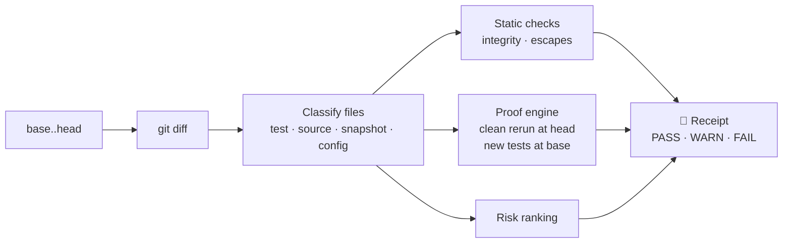

<div align="center">

# 🧾 trustbut

### Trust, but verify, for AI coding agents.

**Your agent said it's done and the tests pass. trustbut shows you what's actually true.**

[](https://github.com/isAlmogK/trustbut/actions/workflows/ci.yml)
[](LICENSE)
[](https://nodejs.org)
[](docs/ROADMAP.md)

🧾 *Verified by trustbut: every pull request to this repo carries its own trustbut receipt.*

[Why](#why-im-building-this) · [Install](#install) · [Languages](#supported-languages-and-test-runners) · [Usage](#usage) · [Config](#configuration-trustbutjson) · [What it checks](#what-it-checks) · [CI](#use-it-in-ci) · [How it works](#how-it-works) · [FAQ](#faq) · [Roadmap](docs/ROADMAP.md)

</div>

---

trustbut is a local command-line tool that produces a **receipt** for any change an AI coding agent makes. It reruns your tests from scratch, checks whether the agent's new tests actually prove anything, and flags skipped tests, deleted assertions and silenced type checks. Then it gives you a **PASS / WARN / FAIL** verdict you can read in 30 seconds.

It works with **any agent** (Claude Code, Codex, Cursor, Gemini CLI, OpenCode, Copilot) and **every major language** (JavaScript/TypeScript, Python, Go, Rust, Java, Kotlin, C#, Ruby, PHP, Dart/Flutter and Swift) because it only needs git and your test runner. No LLM, no server, no account. Your code never leaves your machine.

```console
$ npx github:isAlmogK/trustbut verify

## 🧾 Receipt: WARN

`3f2a91c` → `8be04d1` · runner: vitest

**Tests (clean checkout):** 41 passed · 0 failed · 1 skipped
**New/changed tests:** 1 prove the change · 1 pass without it

### Findings
- ⚠ **Test passes without the change** · `test/auth.test.ts`: rejects expired token
- ⚠ **Test skipped** · `test/auth.test.ts:88`: it.skip('handles clock skew', () => {
- ⚠ **cast to any** · `src/auth/session.ts:41`: const claims = decoded as any;

### Review these first
1. `src/auth/session.ts`: auth/permissions, has findings
2. `package.json`: dependencies
```

When the suite fails at head, the receipt also lists the failing tests. If `package.json` declares dependencies that aren't installed in your `node_modules` (a stale install), a `deps-not-installed` warning names them, because both runs link and use your installed dependencies. See the finding ids in [docs/SPEC.md](docs/SPEC.md).

The output is Markdown, so the same receipt reads cleanly in your terminal and renders properly in a pull request or a CI job summary.

## Why I'm building this

AI agents now write a large share of the code I ship. Writing it is no longer the slow part. **Checking it is.**

Agents are good, and they are also confidently *almost right*. An agent reports "all tests pass" while the suite is red. It adds a test that would pass with or without its change. It skips the one test that was failing, or casts to `any` to make a type error go away. None of this is malicious; it's what happens when a system is optimised to finish the task. But it means every "done" needs checking, and reading the diff alone won't show what actually ran.

The data says I'm not alone:

- In the [2026 Stack Overflow survey](https://survey.stackoverflow.co/2026/ai), **48%** of developers trust AI output when they can easily validate it, but only **16%** trust it for most tasks. The gap between those numbers is the problem trustbut works on.
- In 2025, **66%** of developers named "almost right, but not quite" as their top frustration with AI tools ([InfoWorld on the 2025 survey](https://infoworld.com/article/4031673/ai-use-among-software-developers-grows-but-trust-remains-an-issue-stack-overflow-survey.html)).
- Armin Ronacher put it well in [The Final Bottleneck](https://lucumr.pocoo.org/2026/2/13/the-final-bottleneck/): generating code is now cheaper than reviewing it, and the human stays accountable.

The existing tools don't close that gap. AI code reviewers read the diff and comment, but they never rerun anything. Agent vendors are adding their own checks, but a vendor grading its own agent is a weak audit, and most teams use more than one agent anyway.

So I want something **independent, deterministic and local**: evidence, not opinions. trustbut doesn't ask an AI whether the code looks right. It runs things and reports what is true.

## Install

> [!NOTE]
> trustbut is in early alpha and **not on npm yet**. Until the first release, run it straight from GitHub; the build happens automatically.

**Requirements:** Node.js 22 or newer, git, and a repository with tests in one of the [supported languages and test runners](#supported-languages-and-test-runners), or any runner that can write JUnit XML. The toolchain of your project (Go, Cargo, Maven, .NET, Composer, …) must be installed, as it is when you run the tests yourself.

**Run without installing (recommended):**

```bash
npx github:isAlmogK/trustbut verify
```

**Install globally:**

```bash
npm install -g github:isAlmogK/trustbut
trustbut verify
```

**From source:**

```bash
git clone https://github.com/isAlmogK/trustbut.git
cd trustbut
npm ci
npm link
```

Once it's published, `npx trustbut verify` will work too.

## Usage

Run it in your repository after an agent finishes:

```bash
trustbut verify            # the committed work on your branch
trustbut verify --working  # uncommitted work too (tracked edits plus untracked files)
```

By default trustbut compares your branch with the point where it split off `main` (or `master`), the same way a GitHub pull request shows its diff.

### Common recipes

```bash
# Compare against a specific branch or commit
trustbut verify --base develop
trustbut verify --base HEAD~3

# Verify uncommitted work (the agent hasn't committed yet)
trustbut verify --working

# Faster: rerun only the new and changed test files at head
trustbut verify --quick

# The tests live in a subfolder, or the config lives outside the repo
trustbut verify --root services/api
trustbut verify --config ~/configs/myapp.trustbut.json

# Gate a script or CI job on warnings as well as failures
trustbut verify --strict

# Machine-readable output
trustbut verify --json > receipt.json
```

### Options

| Option | Description | Default |
|---|---|---|
| `-b, --base <ref>` | Base branch or commit, compared from its merge-base with head | `origin/main`, `main`, `origin/master` or `master` |
| `--head <ref>` | The commit to verify (not with `--working`) | `HEAD` |
| `--working` | Verify uncommitted work: tracked edits plus untracked, non-ignored files, snapshotted without touching your index | off |
| `--runner <name>` | Force a test runner, any name from the [table below](#supported-languages-and-test-runners) | detected automatically |
| `--root <dir>` | Package folder to run the tests in, relative to the repo root (overrides `root` in the config) | `.` |
| `--config <path>` | Use this config file instead of `.trustbut.json` at head; it may live outside the repo | `.trustbut.json` |
| `--quick` | At head, rerun only the new and changed test files | off (full suite) |
| `--strict` | Exit with `1` on WARN as well as FAIL | off |
| `--json` | Print the receipt as JSON instead of Markdown | off |

### Verdicts and exit codes

| Verdict | Meaning | Exit code |
|---|---|---|
| ✅ **PASS** | Tests are green from a clean checkout, the new tests prove the change, and nothing suspicious was found | `0` |
| ⚠️ **WARN** | Something deserves a human look: a test that passes without the change, a skipped test, a silenced check | `0` (`1` with `--strict`) |
| ✖️ **FAIL** | Tests fail from a clean checkout, a changed test fails, or a test was focused (`.only`) | `1` |
| — | Usage or runtime error, e.g. an unknown ref or option | `2` |

> [!TIP]
> By default trustbut only looks at **committed** changes. If you have uncommitted work, the receipt says so. Commit first, or pass `--working` to include it.

## Supported languages and test runners

trustbut picks the runner by looking at the package folder (the repo root, or `root` / `--root`) as committed at head (with `--working`, your working tree). If several match, the most specific one wins; force one with `--runner <name>` or `"runner"` in the config.

| Runner | Language | Detected by | Runs | Notes |
|---|---|---|---|---|
| `vitest` | JS / TS | `vitest` dependency, or `vitest.config.*` / `vitest.workspace.*` | `vitest run --reporter=junit` | Wins over Jest when both are present |
| `jest` | JS / TS | `jest` dependency or config, `jest.config.*`, or a `jest-expo` / `react-native` preset | `jest --ci --json --runTestsByPath <files>` | Works for Expo and React Native apps |
| `mocha` | JS / TS | `mocha` dependency or `.mocharc.*` | `mocha --reporter json` | |
| `node-test` | JS / TS | `scripts.test` in `package.json` uses `node --test` | `node --test` | Uses the built-in `node:test` runner |
| `pytest` | Python | `pytest.ini`, `conftest.py`, `tox.ini`, or `[tool.pytest` in `pyproject.toml` | `python -m pytest -q --junitxml` | Uses the checkout's `.venv` / `venv` if present |
| `go` | Go | `go.mod` | `go test -json -count=1 ./...` | Add `"args": ["-p", "1"]` for packages that share a database or emulator |
| `cargo` | Rust | `Cargo.toml` | `cargo nextest run` if installed, else `cargo test --no-fail-fast` | Also checks `#[cfg(test)]` modules in source files. Proofs come from integration tests under `tests/`: inline `#[cfg(test)]` tests run in the suite but give no fail-before / pass-after proof, since they live in the source file being changed |
| `maven` | Java / Kotlin | `pom.xml` (the `mvnw` wrapper is preferred) | `mvn -B test` (Surefire reports) | |
| `gradle` | Java / Kotlin | `build.gradle(.kts)` or `settings.gradle(.kts)` (the `gradlew` wrapper is preferred) | `gradle test --continue` | |
| `dotnet` | C# | a `.sln`, `.slnx`, `.csproj` or `.fsproj` in the root | `dotnet test` (TRX results) | With several projects it prefers the solution file |
| `rspec` | Ruby | `.rspec`, or `spec/` plus `rspec` in the `Gemfile` | `bundle exec rspec --format json` | Plain `rspec` when there is no Gemfile |
| `phpunit` | PHP | `phpunit.xml(.dist)`, or `phpunit/phpunit` in `composer.json` | `vendor/bin/phpunit --log-junit` | Runs `composer install` in the temporary checkout, since `vendor/` isn't tracked |
| `dart` | Dart | `pubspec.yaml` with a `test` dev dependency | `dart test --reporter json` | Runs `dart pub get` first when `.dart_tool` is missing |
| `flutter` | Dart / Flutter | `pubspec.yaml` with the Flutter SDK | `flutter test --machine` | |
| `swift` | Swift | `Package.swift` | `swift test --parallel --verbose --xunit-output` | Swift Package Manager projects |
| `command` | anything | never detected; chosen with `command` in the config | your command | See below |

Each runner's own report (JUnit XML, JSON events or TRX, depending on the tool) is turned into the same per-test results, so each language gets the same fail-before / pass-after proof.

### Any other runner: the `command` runner

If your tests run through something not listed, point trustbut at a command that writes **JUnit XML**:

```json
{
  "command": "./run-tests.sh {files}",
  "junit": "test/reports/junit.xml"
}
```

`{files}` is replaced with the quoted changed test files (and with nothing for a full run). Without `junit`, trustbut reads the command's stdout if it is JUnit XML. Setting `command` selects the `command` runner automatically.

## Configuration (`.trustbut.json`)

Everything is optional; most projects need no config at all. Put `.trustbut.json` in the repo root. trustbut reads it **as committed at head** (so the version under review is the one used), then falls back to the working-tree file. `--config <file>` uses a different file instead, which can live outside the repo. Unknown keys and wrong types are errors (exit code `2`) that list the allowed keys; a `$schema` key is ignored.

| Key | Type | Default | Description |
|---|---|---|---|
| `root` | string | `"."` | Package folder relative to the repo root. Runners are detected and run there, and only changed test files under it are rerun (changed tests elsewhere are listed as not run). Must stay inside the repo and exist at head (otherwise exit code `2`). `--root` overrides it. |
| `runner` | string | detected | Force a runner from the table above. `--runner` overrides it. |
| `command` | string | none | The `command` runner: shell command to run. `{files}` becomes the quoted test files (nothing for a full run). |
| `junit` | string | none | The `command` runner: JUnit XML file the command writes, relative to `root`. |
| `setup` | string | none | Shell command started in the background before **each** test run (for example an emulator or database), and always killed afterwards. If it exits non-zero before the tests start, the run stops with exit code `2`. |
| `setupReadyPattern` | regex string | none | Tests start as soon as `setup` prints a line matching this (stdout or stderr). |
| `setupWaitSec` | number, 0 to 2,000,000 | `5` | How long to wait for `setup`; with `setupReadyPattern` it is the maximum wait. |
| `env` | object of strings | none | Extra environment variables for every test run and for `setup`. |
| `args` | string[] | none | Extra arguments added to the runner's command: before the test files (or packages, selectors) for most runners; for Maven, Gradle and .NET at the end; for `swift` after the `--filter` options; for the `command` runner appended (shell-quoted) at the very end of the command. |
| `timeoutSec` | number, up to 2,000,000 | `900` | Time limit for each test run; the receipt says when a run timed out. |

### Examples

**1. A Go backend with a Firebase emulator, in a subfolder**

```json
{
  "root": "backend",
  "args": ["-p", "1"],
  "setup": "firebase emulators:start --only firestore,auth",
  "setupReadyPattern": "All emulators ready",
  "setupWaitSec": 90,
  "env": { "FIRESTORE_EMULATOR_HOST": "127.0.0.1:8080" }
}
```

`-p 1` runs packages one at a time so they don't fight over the emulator. The emulator is started before the head run and again before the base run, and always shut down.

**2. An Expo / React Native app with Jest**

```json
{
  "runner": "jest",
  "args": ["--silent"]
}
```

Usually you don't need any config: `jest-expo` and `react-native` presets are detected. Dependencies are linked from your checkout, so there's no reinstall.

**3. Vitest in a `functions/` subfolder**

```json
{ "root": "functions" }
```

Or skip the file and run `trustbut verify --root functions`.

**4. Any other tool, through the `command` runner**

```json
{
  "command": "./scripts/run-tests.sh {files}",
  "junit": "build/test-results/junit.xml",
  "timeoutSec": 1800
}
```

> [!WARNING]
> `command` and `setup` are shell commands that run as part of verification, from the config at head, just like a changed `test` script in `package.json` would. Only verify code you'd be willing to run.

## What it checks

### 1. A clean rerun

Your test suite runs in a fresh, temporary `git worktree` at head, not in your working directory and not by trusting the agent's own run. A red suite is a **FAIL**.

### 2. Fail-before / pass-after proof

This is the core idea. Every new or changed test also runs against the **base** commit:

| Before the change | After the change | Result |
|---|---|---|
| fails | passes | ✅ **Proves the change** |
| passes | passes | ⚠️ **Passes without the change**: the test doesn't check the new behaviour |
| — | fails | ✖️ **Fails at head** |
| — | skipped | ⚠️ **Skipped** |
| couldn't run (e.g. imports code that didn't exist yet) | passes | ✅ Counted, but marked as *couldn't run at base* |

### 3. Test integrity

| Finding | Severity |
|---|---|
| Test focused (`it.only`, `describe.only`, `fit`, `fdescribe`, RSpec `focus: true`, Dart `solo: true`) | ✖️ FAIL |
| Test skipped (`it.skip`, `xit`, `@pytest.mark.skip`, `t.Skip()`, `#[ignore]`, `@Disabled`, `[Ignore]`, `markTestSkipped`, `XCTSkip`, `skip:` …) | ⚠️ WARN |
| Tests removed (net count) | ⚠️ WARN |
| Assertions removed (net count, including `self.assertEqual` style) | ⚠️ WARN |
| Snapshot changed or deleted | ⚠️ WARN |
| Test or coverage config changed | ⚠️ WARN |
| Source changed but no tests were added or changed | ⚠️ WARN |

### 4. Escapes

New lines that silence the type checker, linter or coverage:

| Language | Skip / focus markers | Escapes flagged |
|---|---|---|
| TypeScript / JavaScript | `.only`, `fit`, `fdescribe` (FAIL); `.skip`, `.todo`, `xit`, `xdescribe` | `as any`, `: any`, `@ts-ignore`, `@ts-nocheck`, `@ts-expect-error`, `eslint-disable`, `istanbul` / `c8` / `v8 ignore` |
| Python | `@pytest.mark.skip` / `skipif` / `xfail`, `@unittest.skip`, `pytest.skip()`, `self.skipTest()` | `# type: ignore`, `# noqa`, `# pragma: no cover` |
| Go | `t.Skip()`, `t.SkipNow()`, `t.Skipf()` | `//nolint`, `//lint:ignore`, `//go:build ignore`, `unsafe.*` |
| Rust | `#[ignore]` | `#[allow(…)]`, `#[expect(…)]`, `unsafe` blocks |
| Java | `@Disabled`, `@Ignore` | `@SuppressWarnings`, `@SuppressFBWarnings`, `NOPMD`, `CHECKSTYLE:OFF` |
| Kotlin | `@Disabled`, `@Ignore` | `@Suppress`, `@SuppressLint`, `ktlint-disable` |
| C# | `[Ignore]`, `[Explicit]`, `Skip =`, `Assert.Ignore()` | `#pragma warning disable`, `SuppressMessage`, `#nullable disable`, `ExcludeFromCodeCoverage` |
| Ruby | `focus: true` / `:focus` and `fit` (FAIL); `skip`, `pending`, `xit` | `rubocop:disable`, `:nocov:` |
| PHP | `markTestSkipped()`, `markTestIncomplete()`, Pest `->skip()` / `->todo()` | `@phpstan-ignore`, `@psalm-suppress`, `phpcs:ignore`, `@codeCoverageIgnore`, `@` error suppression |
| Dart | `solo: true` (FAIL); `skip: true` / a reason string, `@Skip` | `// ignore:`, `// ignore_for_file:`, `coverage:ignore-*` |
| Swift | `XCTSkip`, `XCTSkipIf`, `.disabled(…)` | `swiftlint:disable`, `@unchecked Sendable` |

Checks look at real code and comments only, so a string or regex that merely *mentions* `it.only` doesn't trigger a false alarm. Removed tests and assertions are counted per language too (`@Test`, `func Test…`, `#[test]`, `assert_eq!`, `Assert.*`, …).

### 5. Review these first

A ranked list of the files that deserve your attention: auth and permissions, database migrations, CI pipelines, dependencies, secrets and env files, infrastructure, agent config (`.claude/`, `AGENTS.md`, …), files with findings, and very large changes.

## Use it in CI

Add a receipt to every pull request, shown in the job summary. A FAIL fails the job:

```yaml
# .github/workflows/trustbut.yml
name: trustbut
on: pull_request
permissions:
  contents: read
jobs:
  receipt:
    runs-on: ubuntu-latest
    steps:
      - uses: actions/checkout@v4
        with:
          fetch-depth: 0          # trustbut needs history to find the merge-base
      - uses: actions/setup-node@v4
        with:
          node-version: 22
      - run: npm ci
      - name: trustbut receipt
        shell: bash               # keeps trustbut's exit code through the pipe
        env:
          BASE_REF: ${{ github.base_ref }}
        run: npx github:isAlmogK/trustbut verify --base "origin/${BASE_REF}" | tee -a "$GITHUB_STEP_SUMMARY"
```

The example uses Node because trustbut does; add your own language's `setup-*` step and dependency install (for example `actions/setup-go`) before the trustbut step, and a `.trustbut.json` in the repo if your tests need setup. A dedicated GitHub Action that posts the receipt as a PR comment is on the [roadmap](docs/ROADMAP.md).

## How it works



- **Throwaway worktrees.** Both runs happen in temporary `git worktree`s that are always removed afterwards. Your working directory is never touched. Dependencies (`node_modules`, `.venv`) are linked from your checkout instead of reinstalled; other toolchains (Go, Cargo, Maven, …) use their usual caches.
- **Runner and language registries.** Each runner is a small adapter that turns a test command into per-test results, and each language declares how to read its comments, strings and test markers. Adding either is one file.
- **Deterministic.** The same commits give the same receipt. There's no model, no sampling and no network call in the core.

## FAQ

<details>
<summary><b>Does it send my code anywhere or use an LLM?</b></summary>

No. trustbut runs entirely on your machine with git and your own test runner. There is no AI model, no telemetry and no account.
</details>

<details>
<summary><b>Which agents does it work with?</b></summary>

All of them. trustbut verifies the *result* (your git history and your tests), so it doesn't matter whether Claude Code, Codex, Cursor, Gemini CLI, OpenCode, Copilot or a human wrote the change. Deeper integrations that read agent transcripts are on the roadmap.
</details>

<details>
<summary><b>Is it a replacement for code review?</b></summary>

No. It's the evidence you want *before* a review: did the tests really run, do the new tests prove anything, and what got silenced. It points your attention at the right files so a human review takes minutes, not an hour.
</details>

<details>
<summary><b>Isn't running the tests twice slow?</b></summary>

The base run only executes the new and changed test files, not the whole suite. Use `--quick` to also limit the head run to those files.
</details>

<details>
<summary><b>Is it safe to run?</b></summary>

trustbut runs your repository's tests, which means running your code, the same trust as running `npm test` or `pytest`. It does this in temporary worktrees and never modifies your checkout. In CI, use `pull_request` (not `pull_request_target`) with read-only permissions, as in the example above.
</details>

<details>
<summary><b>Why "trustbut"?</b></summary>

From "trust, but verify." Agents are genuinely useful, so keep trusting them, but check the evidence before you merge. The command reads as the idea: `trustbut verify`.
</details>

## Roadmap

- **v0.2 (done, in review):** every language, a runner registry and `.trustbut.json`, `--working`
- **v0.3:** GitHub Action with PR comments, hooks that stop an agent from saying "done" on a red receipt, npm release
- **v0.4:** the receipt format as an open spec
- **Later:** transcripts and claim checks, mutation testing on changed lines, `trustbut compare`, a local web UI

See the full [roadmap](docs/ROADMAP.md) and the [design spec](docs/SPEC.md).

## Contributing

Contributions are welcome, especially **real agent mistakes the receipt should have caught**. Open an issue with a minimal repro; it becomes a test scenario before it gets a fix.

```bash
npm ci
npm test           # unit and end-to-end tests (real git repos, real test runs)
npm run typecheck
npm run build
npm run receipt   # trustbut's receipt for your branch; run before opening a PR
```

Every pull request gets a trustbut receipt in the CI job summary, and pull requests from this repository also get it as a sticky comment (fork PRs get the job summary only, since GitHub gives them a read-only token). Run `npm run receipt` locally first so there are no surprises.

trustbut is built with AI coding agents and verified by itself: every pull request gets its own trustbut receipt in CI. The rules agents follow in this repo are in [AGENTS.md](AGENTS.md).

## License

[Apache-2.0](LICENSE)

---

<div align="center">

Built by [@isAlmogK](https://github.com/isAlmogK). If trustbut saves you from a bad merge, a ⭐ helps others find it.

</div>
